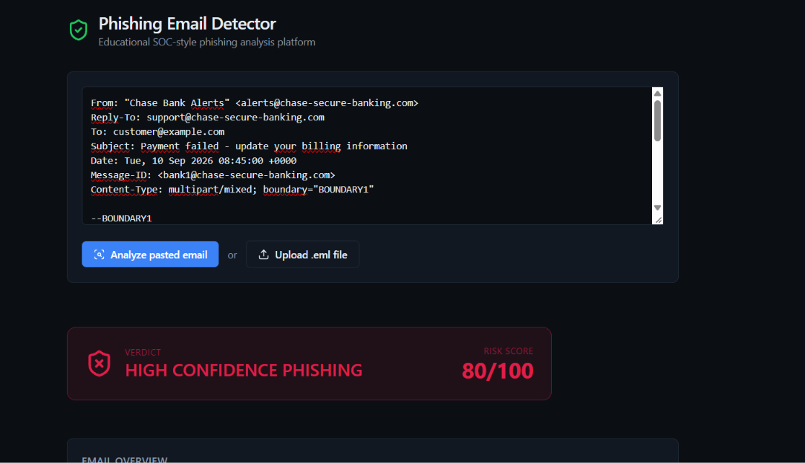
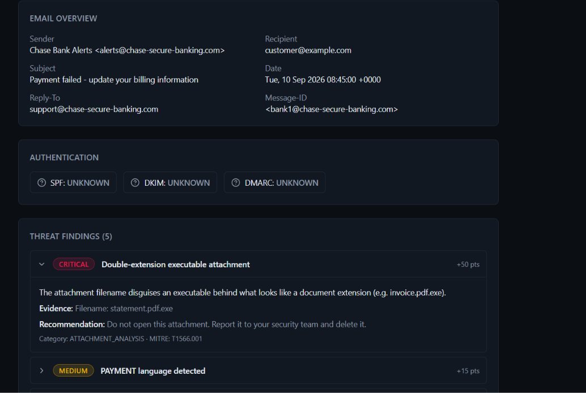
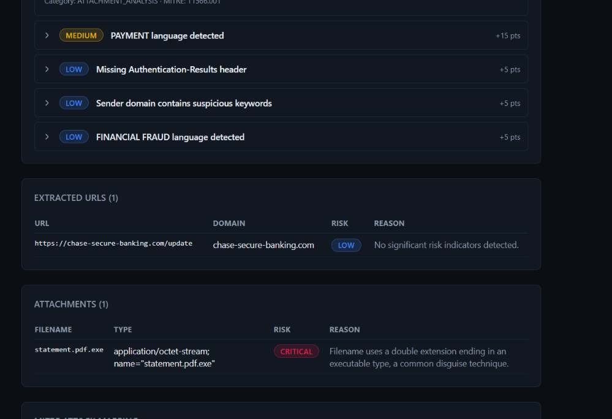
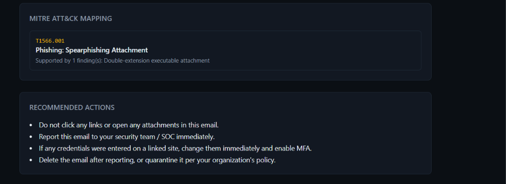

# Phishing Email Detector

Plateforme **éducative et défensive**, de type SOC, qui analyse un email suspect
(texte collé ou fichier `.eml`) et produit un **score de risque explicable** :
chaque point du score est justifié par un *finding* précis, avec preuve,
recommandation et mapping MITRE ATT&CK.

> Un outil qui répond juste « phishing » ne sert à rien à un analyste.
> Ici, le verdict est la somme transparente de constatations traçables.

## Aperçu

### Verdict et score de risque


### Vue d'ensemble de l'email et finding critique


### Findings détaillés, URLs extraites et pièces jointes


### Mapping MITRE ATT&CK et actions recommandées


*Captures réalisées avec l'email synthétique `samples/fake-banking-notification.eml`
(score 80/100, verdict HIGH CONFIDENCE PHISHING).*

## Fonctionnalités

- Analyse d'un email collé ou d'un fichier `.eml` (parsing MIME)
- Extraction : expéditeur, destinataire, sujet, date, Reply-To, Message-ID, URLs, pièces jointes
- **7 analyseurs indépendants** :

| Analyseur | Détecte |
|---|---|
| `HeaderAnalyzer` | SPF/DKIM/DMARC en échec, authentification absente, Reply-To différent du From |
| `SenderAnalyzer` | Nom affiché qui imite une marque, domaine lookalike, punycode |
| `DomainAnalyzer` | Typosquatting (distance de Levenshtein), décodage punycode |
| `UrlAnalyzer` | Texte affiché ≠ lien réel, IP au lieu d'un domaine, raccourcisseurs, `@`, TLD abusés |
| `AttachmentAnalyzer` | Double extension (`facture.pdf.exe`), exécutables, macros Office, archives |
| `ContentKeywordAnalyzer` | Langage d'ingénierie sociale (7 catégories) |
| `HtmlAnalyzer` | iframes, scripts, éléments cachés, formulaires, pixels de tracking |

- **Scoring transparent** et configurable (`scoring-weights.yml`)
- **Mapping MITRE ATT&CK** (T1566.001, T1566.002)
- Historique des analyses stocké en base
- Dashboard sombre type SOC

## Scoring

| Sévérité | Points |
|---|---|
| LOW | +5 |
| MEDIUM | +15 |
| HIGH | +30 |
| CRITICAL | +50 |

Le total est plafonné à 100.

| Score | Verdict |
|---|---|
| 0–24 | SAFE |
| 25–49 | SUSPICIOUS |
| 50–74 | LIKELY PHISHING |
| 75–100 | HIGH CONFIDENCE PHISHING |

Exemple (`fake-banking-notification.eml`) : double extension `.pdf.exe` (+50),
langage PAYMENT (+15), authentification absente (+5), mot-clé suspect dans le
domaine (+5), langage FINANCIAL_FRAUD (+5) = **80/100**.

Les SPF/DKIM/DMARC en échec sont des **indicateurs de risque**, jamais une preuve
de phishing à eux seuls (listes de diffusion et transferts les font échouer).

## Architecture

```
Email / .eml
     │
EmailParser  (Jakarta Mail pour .eml, parseur de secours pour le texte)
     │
     ├── HeaderAnalyzer
     ├── SenderAnalyzer
     ├── UrlAnalyzer
     ├── AttachmentAnalyzer
     ├── ContentKeywordAnalyzer
     └── HtmlAnalyzer
     │
RiskScoringEngine  →  MitreAttackMapper
     │
EmailAnalysisService  →  Base de données  →  API REST  →  Dashboard Next.js
```

## Stack

- **Backend** : Java 17, Spring Boot 3.3, Jakarta Mail, Jsoup, Bucket4j, Flyway
- **Base de données** : H2 (par défaut, aucune installation) ou PostgreSQL (profil `postgres`)
- **Frontend** : Next.js 15, TypeScript, Tailwind CSS, Recharts

## Lancer le projet (sans Docker)

Prérequis : Java 17+, Maven, Node.js 18+.

**Terminal 1 — backend**

```bash
cd backend
mvn spring-boot:run
```

Vérification : http://localhost:8080/api/health doit renvoyer `{"status":"UP",...}`.
La base H2 est créée automatiquement dans `backend/data/`.

**Terminal 2 — frontend**

```bash
cd frontend
npm install
copy .env.example .env.local     # Windows  (Linux/macOS : cp .env.example .env.local)
npm run dev
```

Ouvre http://localhost:3000, colle un email ou charge un fichier de `samples/`.

**Tests backend**

```bash
cd backend
mvn test
```

**Option PostgreSQL**

```bash
docker compose up -d postgres
cd backend
mvn spring-boot:run -Dspring-boot.run.profiles=postgres
```

## Emails d'exemple

`samples/` contient 5 emails **synthétiques** (aucun identifiant réel, aucune
infrastructure malveillante réelle) :

| Fichier | Illustre |
|---|---|
| `legitimate-invoice.eml` | Email légitime, authentification valide |
| `fake-password-reset.eml` | Lien affiché ≠ lien réel, URL en IP, urgence, Reply-To suspect |
| `fake-m365-login.eml` | Domaine punycode, formulaire intégré, SPF/DKIM/DMARC en échec |
| `fake-banking-notification.eml` | Double extension `.pdf.exe`, langage de paiement |
| `suspicious-delivery-notification.eml` | Raccourcisseur d'URL, TLD suspect, faux suivi de colis |

## API REST

| Méthode | Route | Rôle |
|---|---|---|
| POST | `/api/analyze/email` | Analyser un email collé (`{"rawEmail": "..."}`) |
| POST | `/api/analyze/eml` | Analyser un fichier `.eml` (multipart, champ `file`) |
| GET | `/api/analysis/{id}` | Récupérer une analyse |
| GET | `/api/analysis/{id}/findings` | Findings d'une analyse |
| GET | `/api/analysis/{id}/urls` | URLs d'une analyse |
| GET | `/api/analysis/{id}/attachments` | Pièces jointes d'une analyse |
| GET | `/api/stats` | Répartition des verdicts, score moyen |
| GET | `/api/health` | Vérification de disponibilité |

## Configuration

- `backend/src/main/resources/scoring-weights.yml` : poids et seuils de verdict
- `backend/src/main/resources/trusted-domains.yml` : domaines de confiance pour la détection de lookalikes

## Sécurité

- Tout email est traité comme **non fiable**.
- Aucune URL n'est visitée ; aucune pièce jointe n'est exécutée ni stockée (métadonnées seulement).
- Le HTML est analysé avec Jsoup, sans exécuter de JavaScript.
- Limite d'upload de 10 Mo, extension `.eml` exigée, protection contre le path traversal.
- Rate limiting : 20 requêtes/minute/IP sur `/api/analyze/*`.
- Erreurs génériques côté client, sans stack trace.
- CORS limité à `http://localhost:3000`.

## Limites connues

- Pas d'âge de domaine (WHOIS) ni de suivi des redirections.
- Le lookalike est détecté par distance d'édition sur le nom entier : un domaine comme
  `chase-secure-banking.com` n'est pas rapproché de `chase.com`.
- Seules les techniques MITRE T1566.001 et T1566.002 sont produites.
- L'entité `EmailHeader` existe mais n'est pas alimentée.
- Le rate limiting est en mémoire (un seul serveur) et se base sur `X-Forwarded-For`.
- Redis et le Docker complet (backend + frontend) ne sont pas implémentés.
- Aucune mesure de couverture de tests n'a été faite.

## Avertissement

Projet à but **éducatif**. Il aide à comprendre la détection de phishing, mais ne
remplace pas une passerelle de messagerie sécurisée ni l'analyse d'un professionnel.
